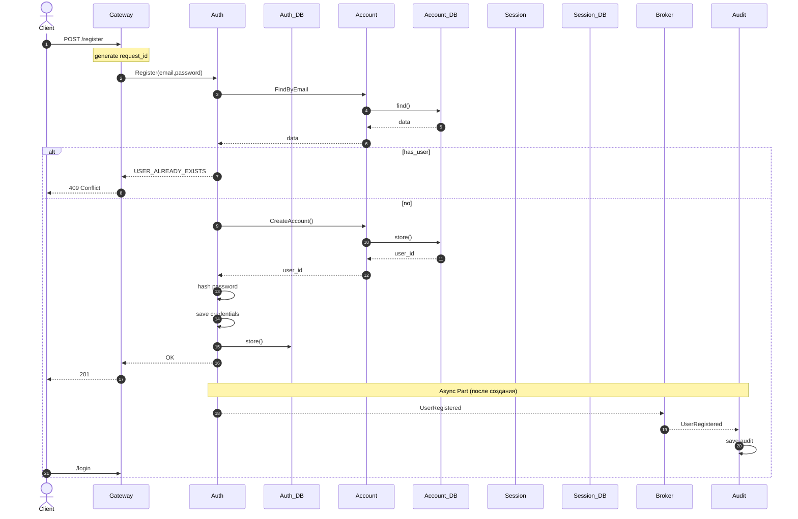
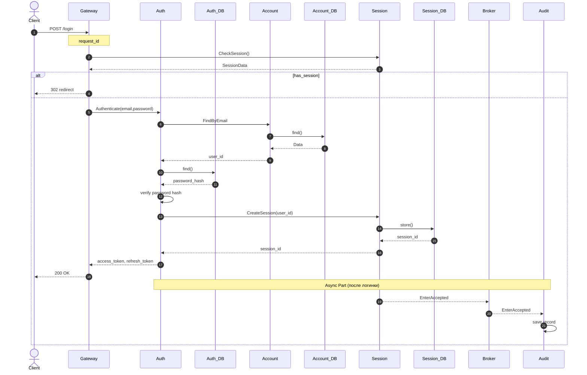
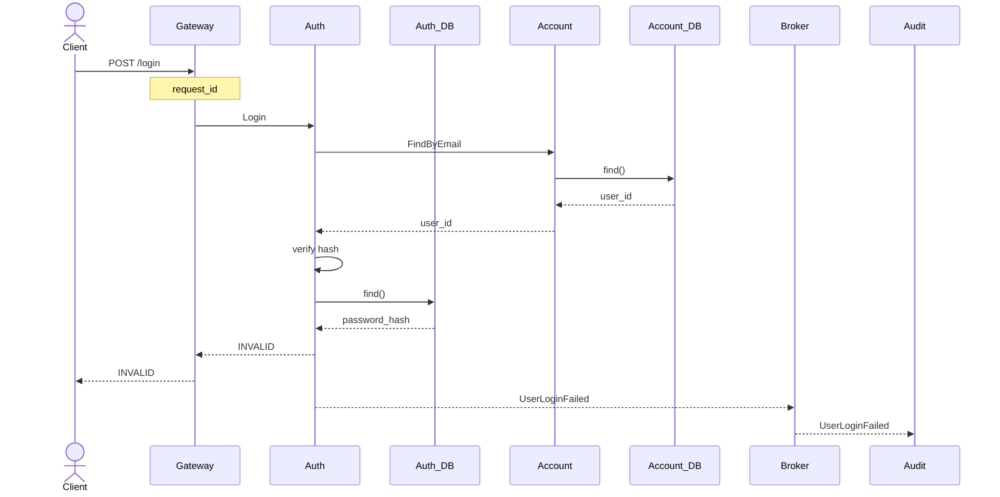
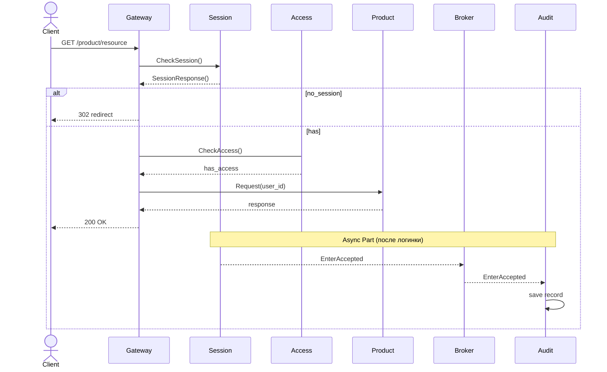
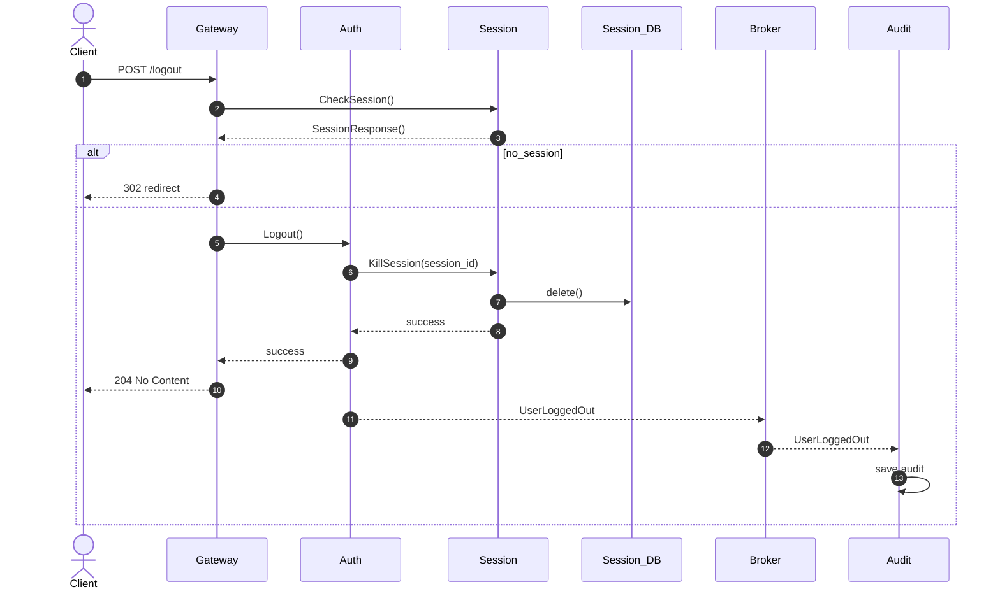
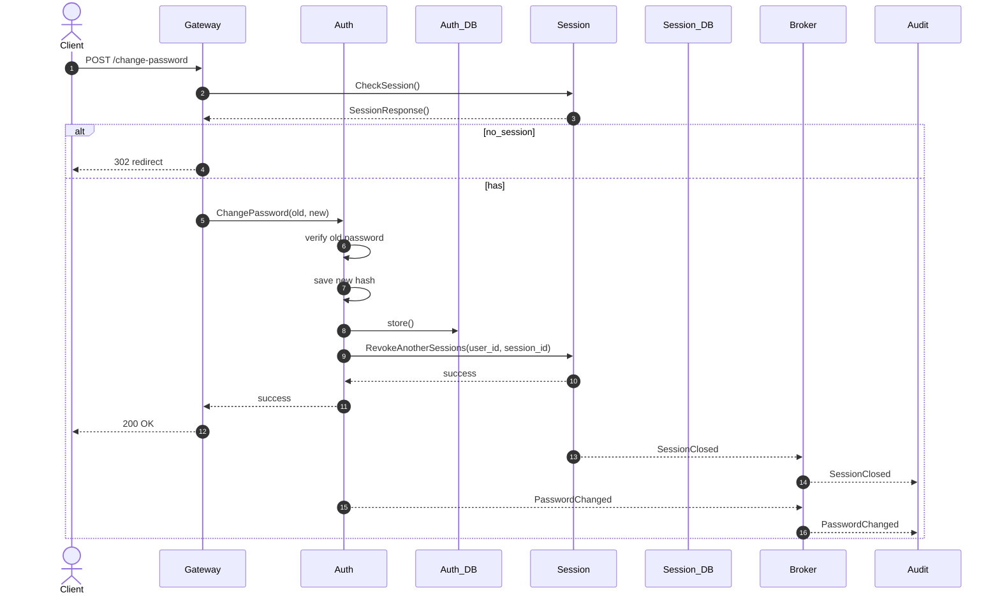

# Лабораторная работа №2 — Решение

## Немножко напоминания владения

| Данные         | Владелец |
|----------------|----------|
| User           | Account  |
| Email, profile | Account  |
| Password Hash  | Auth     |
| Session        | Session  |
| Roles          | Access   |
| Audit Records  | Audit    |

## Граница Sync / Async

```
Client
 |
Gateway
 |
Auth
 |
Account
 |
Session

=================
|| ответ юзеру ||
=================

Broker
 |
Audit
```

## Сценарии и взаимодействие сервисов

### Регистрация (первая)



## Login

[//]: # (TODO Чек сессиии, чтобы я не мог создать сессиию, если послал запрос логинации будучи уже залогированным)



## Login с не тем паролем



## Продукт юзает это так

[//]: # (TODO Ходить в Auth когда сессия закончила жизнь свою)
[//]: # (TODO Remember Me - это часть Auth, а не сессии. Это долгая кука)



## Логаутим



## Смена пароля


